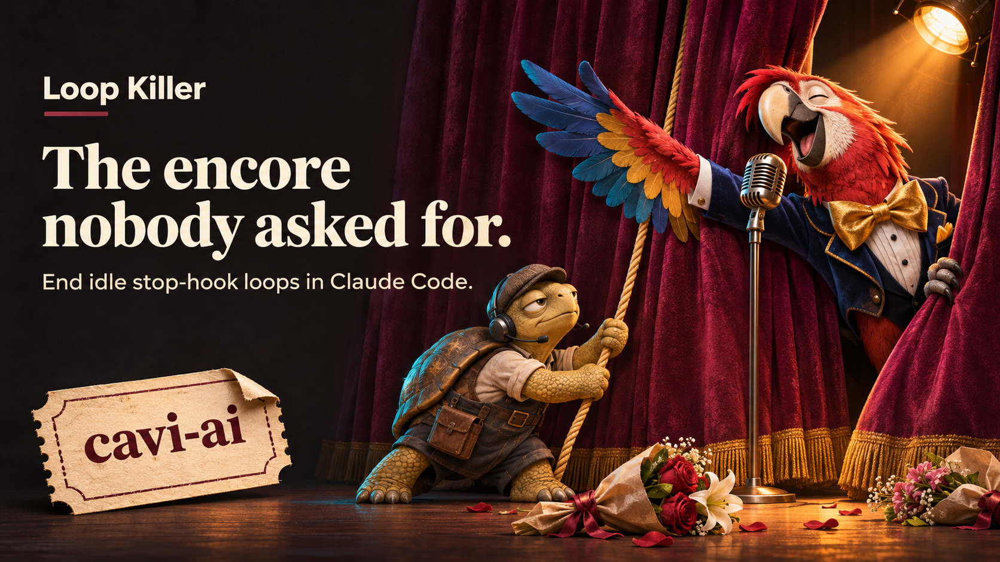

# Loop Killer

[](LICENSE)



**Your agent keeps answering. The hook keeps asking.**

Loop Killer runs `/goal clear` when recognized stop-hook re-prompts produce repeated replies without tool work. It automates the manual clear step and reports the result.

## Install

```sh
claude plugin marketplace add cavi-ai/plugins
```

Then, in a Claude Code session:

```text
/plugin install loop-killer@cavi-ai
```

## When it steps in

| Pattern | Threshold |
| --- | --- |
| Similar replies without tool work | 3 or more consecutive replies |
| Replies without tool work, even when wording changes | 6 or more replies |

Detection applies to the main session only. Tool use ends the trailing run; interrupted, error-ended and subagent turns are ignored.

A toast, log entry and reply notice show the matching rule and command result.

<details>
<summary>Detection rules</summary>

Loop Killer reads the trailing run of recognized re-prompt turns and their answers. A re-prompt is a user message whose text begins with `Stop hook feedback:`, `Stop hook` (optionally preceded by `[`), or `Hook re-prompted`, ignoring case. An answer counts only if it made no tool call; thinking is excluded from its text.

Consecutive replies are similar when their shared words make up at least 60% of the distinct words across both replies (word-set Jaccard overlap). Words are lowercase runs of three or more letters or digits in any script. Two replies with no words are similar only when their text is identical. Every consecutive pair in the run must be similar.

</details>

## Uninstall

```text
/plugin uninstall loop-killer@cavi-ai
```

## License

MIT. See [LICENSE](LICENSE).
